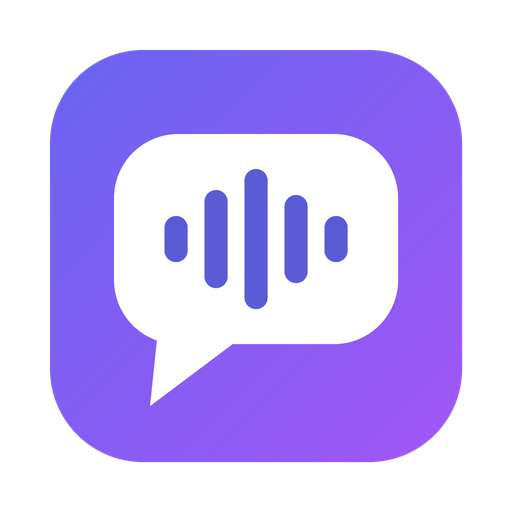
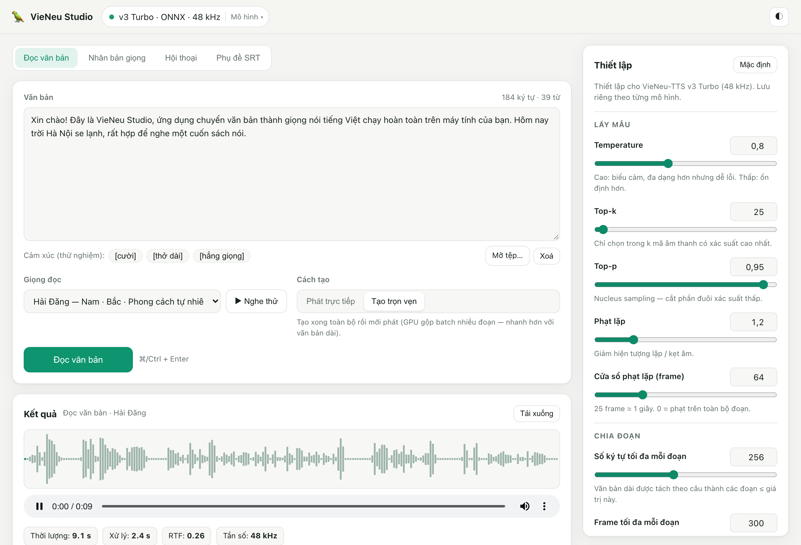
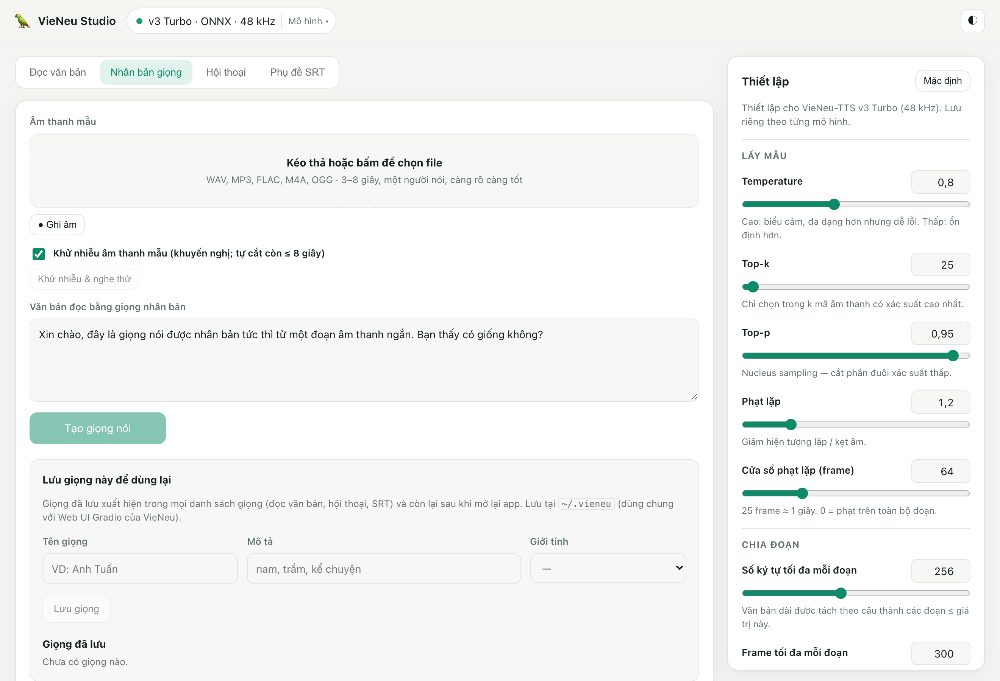
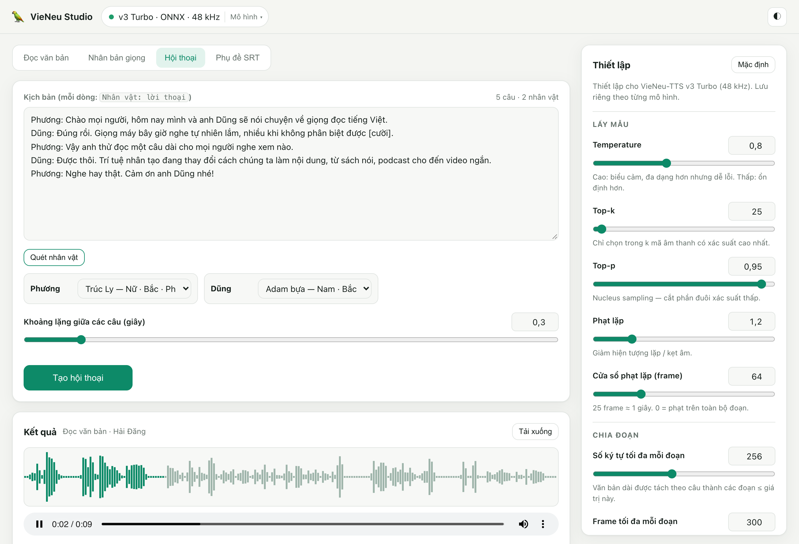
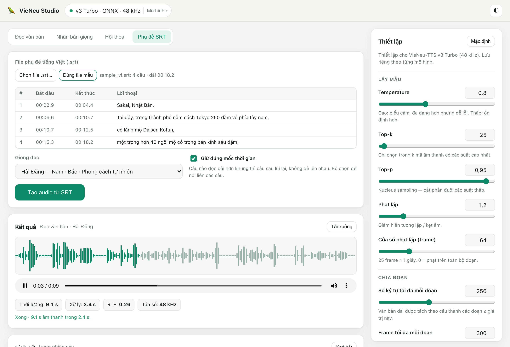
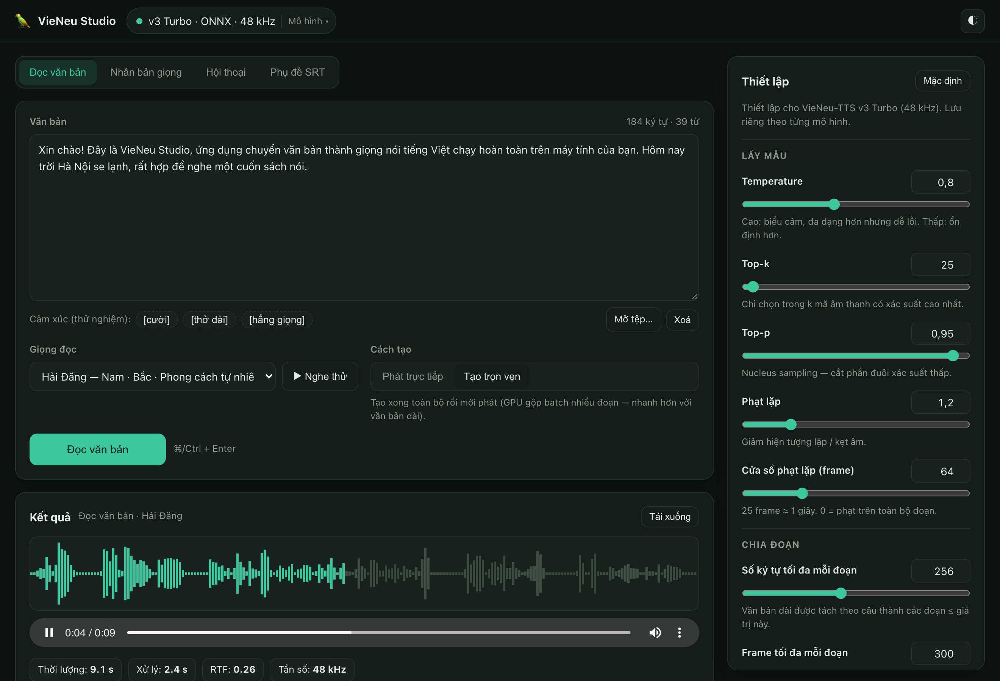

#  V Studio

A desktop app that turns text into natural-sounding speech, in Vietnamese and 8 other languages. It runs entirely on your
computer, so your text and recordings never leave your machine.

Powered by open-source models (both Apache 2.0): [VieNeu-TTS](https://github.com/pnnbao97/VieNeu-TTS) for Vietnamese,
and [Kokoro-82M](https://huggingface.co/hexgrad/Kokoro-82M) (through [kokoro-onnx](https://github.com/thewh1teagle/kokoro-onnx))
for English (US / UK), Spanish, French, Italian, Brazilian Portuguese, Hindi, Japanese and Mandarin.
V Studio is an independent project, not affiliated with either.



## What it does

- **Read text aloud**: paste text, drop in a .txt / .md / .pdf / .docx file or pick a sample, choose a voice and listen right away. In Vietnamese there are 25 voices from the North, Central and South, and numbers, units, and maths and chemistry formulas (`ax² + bx + c = 0`, `2H2 + O2 → 2H2O`) are read correctly.
- **Speak other languages**: switch the model to **Kokoro-82M** (bottom-left of the window) for 54 voices in 9 languages. The language follows the voice you pick. Kokoro is downloaded once (about 350 MB, or 120 MB for the int8 version). For Japanese text with kanji, also install `pip install "v-studio[ja]"`.
- **Clone a voice**: record or upload 3–8 seconds of someone speaking, then make that voice read any text. You can save cloned voices and use them again later.
- **Make podcasts**: write or open a script with several characters, give each one a different voice, and open it in the story studio to edit and redo single lines.
- **Build stories**: a multi-voice story studio where you regenerate only the parts you change.
- **Dub subtitles**: turn an .srt subtitle file into audio that matches the subtitle timing.
- **Teach it pronunciations**: a pronunciation dictionary for names, jargon and abbreviations (`VieNeu → Vi Neu`) that applies everywhere.
- **Add background music**: five built-in tracks generated on your computer (no licensing worries) or your own music, with automatic ducking under the voice.
- **Keep everything**: every clip is saved to a searchable library that survives restarts.
- **Export audio** as WAV, FLAC, OGG or MP3.

## Download

Get the installer for your computer from the [latest release](https://github.com/HieuDevs/v-studio/releases/latest):

| System | File |
|---|---|
| macOS (Apple Silicon) | `V-Studio-x.y.z-macOS-arm64.dmg`: open it and drag the app into **Applications** |
| Windows 10 / 11 | `V-Studio-x.y.z-Windows-x64-Setup.exe` |
| Ubuntu / Debian | `V-Studio-x.y.z-Linux-amd64.deb`: `sudo apt install ./V-Studio-*.deb` |

> [!NOTE]
> The app is not code-signed yet. On macOS, right-click the app and choose **Open** the first time.
> On Windows, if SmartScreen appears, click **More info → Run anyway**.

## Run from source

1. Install [uv](https://docs.astral.sh/uv/).
2. Open the app:

   ```bash
   ./run.sh      # macOS / Linux
   run.bat       # Windows (double-click)
   ```

> [!IMPORTANT]
> The first launch takes a few minutes because the app downloads about 1 GB of voice data. After that, it opens in about 10 seconds.

## How to use

| Tab | Steps |
|---|---|
| **Đọc văn bản** (Read text) | Type or open a file → choose a voice (**▶ Nghe thử** plays a sample) → click **Đọc văn bản**. |
| **Nhân bản giọng** (Clone voice) | Drop in an audio file or click **● Ghi âm** to record → click **Tạo giọng nói** → enter a name and click **Lưu giọng** to keep the voice. |
| **Podcast** | Write or open a script with one line per speaker as `Name: line` → click **Quét nhân vật** to find the speakers → choose a voice for each → click **Tạo hội thoại**. **Sửa từng lượt trong Phòng thu Truyện** turns the script into a story project. |
| **Truyện** (Story) | Add characters and segments, generate each segment, then click **Xuất file truyện** to join them. |
| **Phụ đề SRT** (Subtitles) | Click **Chọn file .srt…** → choose a voice → click **Tạo audio từ SRT**. |
| **Từ điển phát âm** (Pronunciation) | Click **Thêm luật**, type the word and how it should be read. Try it in **Nghe thử cách đọc**. Import or export rules as a text file (`word = reading` per line). |

When it finishes, play the audio in **Kết quả** (Result) and click **Tải xuống** (Download) to save it.
Open **🎵 Nhạc nền** under the result to mix background music into it. Every clip is also kept in **Thư viện** (Library): search it, double-click a title to rename it, or play an older clip again.
Use **Tinh chỉnh giọng** (Voice settings) in the sidebar to change the speaking style, and **Giao diện** to switch between light and dark mode.
Everything the app keeps (library, stories, saved voices, pronunciation rules, music, downloaded models) is stored in `~/.vstudio`
(set `VSTUDIO_HOME` to use another folder). Data from V Studio 1.1 and earlier (`~/.vieneu`) is copied there on first start.

| Clone a voice | Conversation |
|---|---|
|  |  |
| **Subtitles** | **Dark mode** |
|  |  |

## Tips

- For voice cloning, use a clear recording of a single speaker with little background noise.
- On macOS, allow microphone access when asked. If you said no by mistake, turn it back on in *System Settings › Privacy & Security › Microphone*.
- To add laughter or a sigh, click the `[cười]` (laugh), `[thở dài]` (sigh) or `[hắng giọng]` (clear throat) chips under the text box.
